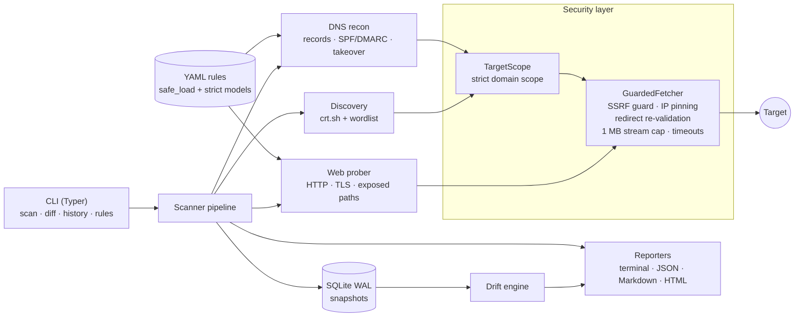

# ReconVigil

**Security-hardened Attack Surface Management & web reconnaissance engine.**
Discover subdomains, audit DNS/email/TLS/HTTP posture, detect subdomain takeovers and exposed
files, then track how your attack surface *drifts* between scans, with reports you can hand to a
client.

[](https://github.com/efe-gucluturk/reconvigil/actions/workflows/ci.yml)


[](LICENSE)

> **Authorized & Educational Use Only.** ReconVigil sends traffic to the targets you give it. Scan only assets
> you own or have written permission to test.

## Features

- **Discovery**: Certificate Transparency (`crt.sh`) + wordlist/permutation brute force, wildcard-DNS
  filtering, `A/AAAA/CNAME/MX/TXT` via `dns.asyncresolver`.
- **DNS & email posture**: missing/permissive SPF (`+all`, `?all`), missing or `p=none` DMARC.
- **Subdomain takeover**: dangling-CNAME + HTTP fingerprint matching for AWS S3, GitHub Pages, Heroku,
  Netlify, Vercel, Azure, Shopify and Fastly.
- **Web & TLS audit**: security headers, CORS misconfiguration, version disclosure, certificate
  expiry/self-signed/hostname checks.
- **Exposure checks**: `/.git/HEAD`, `/.env`, OpenAPI/Swagger, Actuator, `security.txt`, `robots.txt`,
  with strict content validation to avoid soft-404 false positives. Every finding carries a severity,
  CWE ID and remediation.
- **Attack-surface drift**: SQLite (WAL) snapshots and diffs: new/removed assets, changed IPs, new
  endpoints, new/resolved findings.
- **Reports**: Rich terminal, JSON, Markdown, and a self-contained offline dark-mode HTML report.
- **CI-friendly exit codes**: `--fail-on` gates pipelines on severity.

## Architecture



## Security hardening

| Control | How it is enforced |
|---|---|
| **Strict Domain Scope Validation** | `TargetScope` accepts only `target.com` and `*.target.com` on label boundaries (`evil-target.com`, `target.com.evil.com` are rejected). Hostnames/URLs with credentials, IP literals, path traversal, odd ports or control characters are refused. CT data is filtered through the same check. |
| **DNS Rebinding & Private-IP SSRF Guard** | A/AAAA are resolved *before* any request; if **any** answer is private, loopback, link-local, CGNAT, reserved, multicast (incl. IPv4-mapped IPv6) the host is blocked. The validated IP is pinned for the connection (Host/SNI preserved). Cloud-metadata IPs stay blocked even with `--allow-private`. |
| **Redirect-Hop Re-validation** | Redirects are followed manually, bounded, and every hop is re-checked for scope and SSRF. Out-of-scope redirects are recorded, never followed. |
| **1 MB Streaming Response Cap** | Bodies are streamed and cut at 1 MiB; connect/read timeouts plus a total deadline defeat tarpits and slow-drip responses. Bounded `asyncio.Semaphore` concurrency everywhere. |
| **Parameterized SQLite WAL Storage** | All SQL is parameterized; WAL mode; transactional snapshot writes. The CLI refuses to open or overwrite files that are not SQLite databases. |
| **Stored XSS Escaping in HTML Reports** | Every target-controlled value (title, `Server`, CNAME, TLS subject, URLs, evidence) is control-char-stripped and `html.escape()`d; the report has no external resources, no inline handlers, and a CSP pinned to its single script's SHA-256. Markdown and terminal output are escaped too. |
| **Non-Root Container** | Multi-stage build, runtime image has no build tooling and runs as UID/GID `10001`. |
| **Safe parsing & no dangerous primitives** | `yaml.safe_load` only; strict pydantic v2 models; no `eval`/`exec`/`pickle`/`shell=True`; `.env` findings store key names only, never values. `bandit` and ruff `S` rules run in CI. |

## Install

```bash
git clone https://github.com/efe-gucluturk/reconvigil && cd reconvigil
python -m venv .venv && source .venv/bin/activate      # Windows: .venv\Scripts\activate
pip install -e ".[dev]"
reconvigil --help
```

Docker:

```bash
docker build -t reconvigil .
docker run --rm reconvigil                                   # prints --help
docker run --rm -v "$PWD/data:/data" reconvigil scan example.com --format html --output /data/report.html
```

(`./data` must be writable by UID 10001.)

## Usage

```bash
# Full scan with the default terminal report; exits 1 if any HIGH/CRITICAL finding exists
reconvigil scan example.com

# CI gate + shareable reports
reconvigil scan example.com --fail-on medium --format html --output report.html
reconvigil scan example.com --format markdown --output audit.md
reconvigil scan example.com --format json > scan.json

# Offline / lab scans (no crt.sh, private targets allowed, custom ports)
reconvigil scan lab.test --no-ct --allow-private --http-port 8080 --https-port 8443

# Custom wordlist, tuning
reconvigil scan example.com --wordlist subs.txt --concurrency 25 --timeout 5

# Drift between the two latest snapshots, scan history, built-in rules
reconvigil diff example.com --db .reconvigil.db
reconvigil history example.com
reconvigil rules
```

| `scan` option | Default | Notes |
|---|---|---|
| `--db PATH` | `.reconvigil.db` | validated; must be a SQLite file or new |
| `--format` | `table` | `table`, `json`, `markdown`, `html` |
| `--output PATH` | none | writes the json/markdown/html report to a file |
| `--fail-on` | `high` | `critical`, `high`, `medium`, `low`, `none` |
| `--concurrency` | `10` | `1..50` |
| `--timeout` | `8.0` | connect/read seconds (total deadline 2.5x) |
| `--wordlist PATH` | built-in list | max 10 MB |
| `--no-ct` | off | skip passive `crt.sh` lookup |
| `--allow-private` | off | lab only: allow localhost/RFC1918 |

**Exit codes:** `0` clean (or below `--fail-on`), `1` findings at/above threshold, `2` scope/input error
(bad domain, out-of-scope seed, unsafe path, no stored scans for `diff`/`history`).

## Development

```bash
ruff check .
bandit -r src/ -c pyproject.toml
pytest -v          # 100% offline: MockTransport, local asyncio servers, fake DNS/TLS
reconvigil rules
```

## Repository structure

```
src/reconvigil/
  cli.py                 Typer CLI: scan / diff / history / rules
  scanner.py             Pipeline orchestration
  models.py              Strict pydantic models (Finding, Asset, ScanResult, DriftReport…)
  dnsio.py               Async DNS resolver protocol (dnspython)
  security/
    scope.py             Scope validation + SSRF/DNS-rebinding guard
    safe_http.py         Guarded transport/fetcher (pinning, redirects, 1 MB cap, timeouts)
  recon/
    dns_recon.py         CT + brute force, records, SPF/DMARC, takeover
    web_prober.py        HTTP/TLS probing, header grading, exposed paths
  rules/                 takeover_fingerprints.yaml, exposed_paths.yaml
  storage/state_db.py    SQLite WAL snapshots + drift diff
  reporters/             terminal · json_report · markdown_report · html_report
tests/                   Offline deterministic + adversarial suite
Dockerfile · .github/workflows/ci.yml · CLAUDE.md · LICENSE
```

## License

MIT © 2026 Efe Güçlütürk. See [LICENSE](LICENSE).
